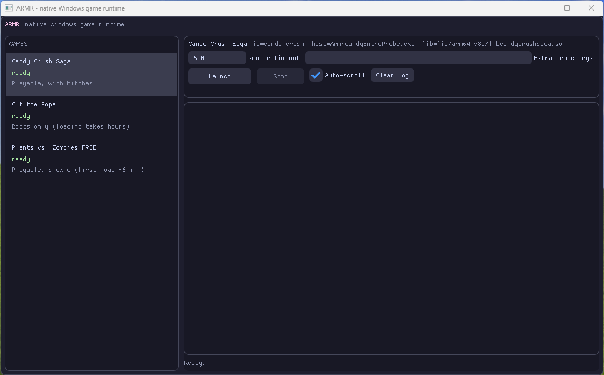

<p align="center"></p>

# ARMR

**Run Android games natively on Windows. No emulator, no VM, no Android image.**

ARMR (pronounced "armor") loads a game's 64-bit ARM native libraries straight
into a Windows process, recompiles their code to x64 on the fly, and answers
everything they ask of "Android" itself: libc, the dynamic linker, JNI,
OpenGL ES, audio, files, and input.

> **Status: experimental research project.** A handful of specific game
> versions boot and render real frames; one is genuinely playable. Every game
> needs hand-written compatibility work, there is no sound yet, and loading
> is slow. It is not a general-purpose Android app player. See
> [Limitations](#limitations).

## What works

| Game (exact version) | State |
| --- | --- |
| Plants vs. Zombies FREE 3.18.0 | **Playable, slowly.** Title, menu, name entry, Adventure level 1, planting, sun collection, pause/resume. The first load takes 5 to 6 minutes, then it runs at roughly 8 fps. |
| Candy Crush Saga 1.333.2.1 | **Playable, with hitches.** Fully lit frames within seconds; menu, Play, and legal swaps with cascades. Multi-second stalls during play. |
| Cut the Rope 4.0.2 | **Boots only.** Unity starts and loads its content catalog and bundles, but loading is extremely slow: a 15-minute single-core run had not shown a visible frame yet. Multi-hour runs have reached the publisher splash, the loading screen, and the main-menu assets. |

All games run **without sound** and need their `arm64-v8a` build. A game
uses several CPU cores while it runs; run one at a time.

## How it works

```text
your .apk/.xapk ──Import-ArmrGame.ps1──▶ apps/<id>/payload      (extracted, local only)
                                                │
games/<id>.profile + .compat + .lua ──▶ ArmrCtrEntryProbe.exe --game <id>
                                                │
   ELF64 loader ─▶ Dynarmic JIT (ARM64 → x64) ─▶ import registry
      ├─ bionic libc and dynamic linker reimplemented on Win32
      ├─ JNI with a synthesized Java object model (no JVM)
      ├─ OpenGL ES 2/3 + EGL ─▶ ANGLE ─▶ Direct3D 11
      └─ Win32 game window with mouse/keyboard input
```

The runtime knows nothing about specific games. Each game is described by
data in `games/`: a profile, an optional JNI policy file, and an optional Lua
script that drives its lifecycle. Details: [docs/ARCHITECTURE.md](docs/ARCHITECTURE.md).

## Quick start

1. **Build.** You need Visual Studio 2022+, CMake, Ninja, a JDK, and vcpkg
   packages. Full instructions: [docs/BUILDING.md](docs/BUILDING.md).

   ```powershell
   .\windows\Build-ArmrAarch64.ps1 -BoostInclude <vcpkg>\installed\x64-windows\include -AngleRoot <vcpkg>\installed\x64-windows
   ```

2. **Import a game** you own. Use the package for the exact version in the
   table above.

   ```powershell
   .\windows\Import-ArmrGame.ps1 -Game pvz1 -Package "D:\Downloads\pvz-free-3.18.0.xapk"
   ```

   Game ids: `pvz1`, `candy-crush`, `ctr`.

3. **Play.** Run `Armr.cmd` for the launcher, or:

   ```powershell
   .\windows\Start-ArmrGame.ps1 -Game pvz1
   ```

   In the game window, Alt (or the right edge) reveals the toolbar. F11
   toggles fullscreen.

   

## Limitations

- **One game at a time.** Each title needs its lifecycle reverse-engineered,
  and its scripts reference offsets in that exact version. Updates break
  profiles.
- **No Google Play Services.** No sign-in, billing, or attestation, so online
  games and anything with anti-cheat or anti-tamper will not run.
- **No sound.** Audio callbacks run at the right pace but output is
  discarded.
- **Slow.** Every guest memory access goes through a checked callback.
  Startup takes minutes and some games hitch during play.

## Repository layout

```text
native-runtime/win/aarch64/   the runtime (loader, JIT glue, libc, JNI, GLES, audio)
native-runtime/win/ui/        the Win32 game window
launcher/                     ImGui game picker
games/                        per-game profiles, JNI policies, Lua scripts
windows/                      build, test, import and launch scripts
docs/                         architecture, building, adding games, policy
```

## Contributing

Read [AGENTS.md](AGENTS.md) and [docs/ADDING-GAMES.md](docs/ADDING-GAMES.md).
`windows\Test-NativeAarch64.ps1` runs the zero-payload test gate and must pass
before a change lands.

## Legal

ARMR is MIT-licensed ([LICENSE](LICENSE)). It contains no game code or
assets and does not download any. Import only games you have a legal right
to use. Game names are trademarks of their owners and appear only to describe
compatibility; ARMR is not affiliated with Electronic Arts, King, ZeptoLab,
or Google. Third-party components: [NOTICE.md](NOTICE.md).
